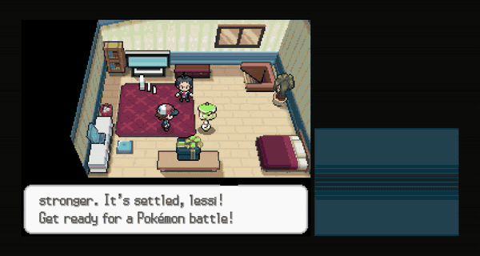

# Contributing to PokeBrawl

Thanks for helping. The long-term goal is every Pokémon with its real learnset and abilities
([docs/roster-plan.md](docs/roster-plan.md)), and that only works if moves and abilities can be
added one at a time by different people. These recipes are how. Sound, music and art are just
as welcome: see [Sound effects](#sound-effects), [Music](#music) and [Art](#art).

Everything here is the approach I took, not the only one or necessarily the best. If you would
rather tackle real-time Pokémon battles from the ground up in a completely different way, you
do not need to contribute here first: take whatever you want from this work for your own
project (the code is MIT; the assets keep their own licenses, see [CREDITS.md](CREDITS.md)).

Before starting something big, open an issue (or comment on an existing one) so two people do
not build the same move.

## Ground rules

- **English everywhere** in code, comments and data. Player-facing text is written in English and
  goes through `tr()` (or `TranslationServer.translate()` outside nodes); see
  [Translations](#translations).
- **One move, one file.** Each move's behavior lives in `game/scripts/moves/<id>.gd`, where `<id>`
  is its [Showdown](https://github.com/smogon/pokemon-showdown) id (lowercase, no spaces:
  `thundershock`, `aurasphere`).
- **Balance numbers live in data**, not in scripts: `game/scripts/data/moves.gd` for moves,
  `game/scripts/data/roster.gd` for Pokémon.
- **Readable first.** Every move needs a startup the opponent can read and a way to answer it
  (dodge, jump, step aside, punish). Write that answer in the move's `counterplay`.
- **Visual style:** Cobblemon's own particle pieces first; whatever is missing, pixel art at
  Cobblemon's density (16 px per meter) with flat color bands and stepped transparency. No smooth
  gradients or soft glows, and nothing that flashes faster than twice per second.
- **Assets:** only Cobblemon assets (respecting their licenses), your own work, or openly licensed
  models compatible with the project's non-commercial use, credited in [CREDITS.md](CREDITS.md)
  with what was changed (Urshifu's, from the Pokemans Pack, CC BY-NC 4.0). Never new assets ripped
  from the official games; the trainer sprites are the one exception left, and
  original ones are welcome (see [Art](#art)).

## Recipe: add a move

Use an existing move as a model. `thundershock` (projectile), `quickattack` (dash, through the
shared `dash.gd`), `flamethrower` (held stream), `hyperbeam` (held beam, through the shared
`energystream.gd`), `aurasphere` (chargeable) and `earthquake` (ground wave) cover the common
shapes.

1. **Research.** Look the move up in Pokkén and Smash (button, does it charge, is it a counter,
   what punishes it) and how it looks in the anime. Add a short entry to
   [docs/move-references.md](docs/move-references.md).

2. **Find its Cobblemon pieces.** Its particle pieces and sequence, if Cobblemon has them, are in
   `game/fx/particles/<move>_*.json` and `game/fx/sequences/<move>.json`.

3. **Add its data** to `Moves.DATA` in `game/scripts/data/moves.gd`, under the Pokémon section it
   belongs to. The header of that file documents every field. The minimum:

   ```gdscript
   "thundershock": {
       "display_name": "Thunder Shock", "script": "res://scripts/moves/thundershock.gd",
       "type": "electric", "cat": "special",
       "cost": 12.0, "cd": 1.0, "startup": 0.16, "active": 0.1, "recovery": 0.22,
       "damage": 52.0, "push": 3.0, "stun": 0.35, "hitstop": 0.05,
       "desc": "A straight discharge from the cheeks. Fast and cheap.",
       "counterplay": "It flies straight: sidestep it or dodge through it.",
       "ai": {"min": 3.0, "max": 18.0, "kind": "projectile", "value": 1.0},
   },
   ```

   `fx_startup`, `fx_active` and `fx_hit` list the Cobblemon pieces to spawn in each phase. `ai`
   tells the AI when to use it (`kind` is one of `projectile`, `engage`, `punish`, `area`,
   `heal`, `stream`, `charge`, `guard`, `decoy`, `buff`).

4. **Write its behavior** in `game/scripts/moves/<id>.gd`. It extends `Action`, which runs the
   three phases (startup, active, recovery) from the data and calls these hooks:

   | Hook | When |
   |---|---|
   | `on_start()` / `in_startup(delta)` | the move begins / every frame of the wind-up |
   | `on_active()` / `in_active(delta)` | hit volumes exist |
   | `on_recovery()` / `in_recovery(delta)` | the punishable part |
   | `on_end(interrupted)` | always, at the end; clean up here |
   | `pose()` | procedural pose on top of the animation: `tilt`, `side`, `stretch`, `anim`… |
   | `armor()` | extra poise while it runs |

   Useful helpers: `hit({...})` creates a hit volume from the data, `aim()` gives the firing
   direction, `to_world()`, `mouth()` and `l.point("<locator>")` give body points,
   `play_sound()` plays a sound, and `l.main.vfx` / `l.main.fx` draw effects. If the move is a
   plain dash, punch or body slam, point `"script"` at the shared `dash.gd`, `punch.gd` or
   `bodyslam.gd` and only add data.

5. **Give it to a Pokémon.** Every Pokémon that learns it in the games (its learnset in
   `species.gd`) can pick it in the Moves screen as soon as its script exists. To make it one
   of a Pokémon's default four, put it in `"moves": [...]` in `game/scripts/data/roster.gd`.

6. **Test it:**

   ```bash
   godot --path game -- --test=moves --p1=<pokemon> --sequence   # capture strip of each move
   godot --headless --path game -- --test=mechanics               # must stay all OK
   godot --headless --path game -- --test=loadouts                # every Pokémon with every move it can pick
   godot --headless --path game -- --test=animations --p1=<pokemon>
   ```

   Then play it against the AI and in training mode (`training.bat`, **F3** shows the hit
   volumes).

7. **Update the translations** (below) and open a pull request with a capture strip or a short
   clip of the move.

## Recipe: add a Pokémon

1. **Model and animations:** with a Cobblemon clone,
   `python tools/import_cobblemon.py <clone>/common/src/main/resources --only=<species>`
   copies its files into `sources/cobblemon/<species>/` and converts them into
   `game/pokemon/<species>/`. Without a Cobblemon model, an openly licensed one
   (`tools/import_pokemans.py` is the example: it fixes what the source's animations need).
2. **Species data:** `python tools/import_species.py --cobblemon <clone> <species>` adds its real
   stats, abilities and learnset to `game/scripts/data/species.gd` (generated; never edit it by
   hand). A form with its own roster entry goes in `FORMS` there.
3. **Battle data:** add its entry to `Roster.POKEMON` in `game/scripts/data/roster.gd` (size,
   mobility, dodge, passive, moves) and its style to `PROFILE` in `game/scripts/ai.gd`. A form is
   one more entry with `echo_of`: it shares its base's cell on the selection wall.
4. **Test:** `--test=animations --p1=<species>` must report no failures, then
   `--aivsai --test=aivsai --p1=<species>` and play it.

## Sound effects

Move and impact sounds and the cries come from Cobblemon. What it does not have is synthesized
in code as a placeholder (`game/scripts/audio.gd`), and those are the first sounds to replace:

| Key | When it plays |
|---|---|
| `dodge`, `jump` | dodging and jumping |
| `footstep`, `fall` | running, landing, being knocked down |
| `light_hit`, `heavy_hit` | hits whose type has no impact sound of its own |
| `armor`, `ko` | a hit that does not interrupt (poise), a KO |
| `charge` | Aura Sphere's charge and the League Stadium's warning before it closes in |
| `ui_ok`, `ui_back` | the menus: accepting and going back |

Also missing: the crowd of the stadiums, the League Stadium's barrier closing in, and the wind of
the Floating Stadium.

- **Format:** OGG Vorbis, 44.1 or 48 kHz, mono for anything placed in the world, short and with
  no silence at the start. Two or three variants of the same sound help (one is picked at
  random): name them `<prefix>_1.ogg`, `<prefix>_2.ogg`...
- **Where:** a folder of its own under `game/sounds/`, and point the key to it in `audio.gd`:
  the `COBBLEMON` map (folder and file prefix) for most keys, which wins over the synthesized
  sound; hits and menu sounds are picked in `impact()` and `ui()`.
- Keep them clear and dry: every move already has its own sound, and the effects must not bury
  them.

## Music

The released builds carry Pokémon arrangements by The Noble Demon, which cannot live in the
repository; the game picks tracks by file name from `game/music/` (see its
[README](game/music/README.md)):

| Prefix | Plays in |
|---|---|
| `menu_` | the menus |
| `select_` | the Pokémon selection and the Moves screen |
| `battle_` | the battles (a new track every battle) |

- **Original music** is the most welcome: menu, selection and battle themes, and one per
  stadium would be even better. If it is yours and released under a license that lets it live
  in the repository (CC BY 4.0 or CC0), it can ship with the source too, not only with the
  builds.
- **Arrangements of Pokémon music** are welcome too, with the arranger's permission; like the
  current ones, they go only inside the released builds.
- **Format:** OGG Vorbis or MP3, any bitrate, made to loop cleanly. It plays quietly under the
  battle, so keep the mix gentle and leave room for the effects.

## Art

The stadiums, the effects and the menus are drawn by code; the Pokémon are Cobblemon's, except
Urshifu, from the Pokemans Pack. Art is
welcome where the game still leans on others or on placeholders:

- **Trainer sprites:** original trainers to replace the games' ones, front and back (today
  there are only front ones; a back one would show when the camera is behind the trainer).
  80 × 80 px, feet on the bottom rows, listed in `game/scripts/data/trainers.gd`.
- **Effect sprites** (`game/fx/tex/custom/`): pieces Cobblemon does not have, in its pixel style.
- **Stadium details:** textures and props for the stadiums, or ideas for new ones.
- **Logo, key art and icons** for the menus, the window and the release page.

Follow the visual style of the [ground rules](#ground-rules): hard pixel art at Cobblemon's
density (16 px per meter), flat color bands, no smooth gradients or soft glows. PNG with
transparency.

## Sending sound, music or art

1. **Open an issue first** with a sample (a clip, a track, a picture) so we agree on the
   direction before you make the whole set.
2. **Send it as a pull request**, or attached to the issue if you do not use Git.
3. **It must be yours**, with a license that allows it in a non-profit fan project (CC BY 4.0
   or CC0 is simplest), and say which in the pull request. Your name, the work and its license
   go into [CREDITS.md](CREDITS.md) and the in-game credits.

## Translations

All text lives in `game/i18n/translations.csv`, one column per language (`keys,en,es`). The key
is the English text.

```bash
python tools/update_translations.py           # adds new keys, lists missing translations
python tools/update_translations.py --check   # only reports; fails if something is missing
```

New keys get empty cells, and an empty cell falls back to English in game. To add a language,
add a column with its code (for example `fr`) and register
`res://i18n/translations.fr.translation` in `game/project.godot` under `[internationalization]`.
Use the official Pokémon names of that language.

## Code style

- GDScript with tabs, typed variables where it helps, `snake_case` names in English.
- `##` doc comments say what a function is for and why, not how. Keep them short.
- Keep logic and visuals apart: effects never deal damage, hit volumes never draw.
- Python tools: standard library plus Pillow where images are involved.

## Pull requests

- One move, ability or fix per pull request when possible.
- Run the mechanics test and `python tools/update_translations.py --check` before opening it.
- Describe how the move plays and what counters it, with captures.

By contributing you agree that your code is released under the project's [MIT license](LICENSE).

## Where it can go

PokeBrawl is small on purpose, but it was built to grow. These are the lines of work it is
ready for, from the most direct to the most ambitious. Any of them is a good place to help.

### More moves, Pokémon and abilities

The content is data first, so adding to it does not mean touching the battle system.

- **Moves.** Each move is an entry in `moves.gd` plus a script, and the scripts share bases
  (dashes, punches, body slams, projectiles, held beams): the 97 moves done today come from 65
  scripts, and many new ones only need data. The ten Pokémon learn 404 moves in the games,
  grouped into families to design them together in
  [docs/learnset-plan.md](docs/learnset-plan.md). As soon as a move's script exists, every
  Pokémon that learns it can pick it in the Moves screen.
- **Pokémon.** Their stats, types, abilities, weights and learnsets are generated from
  Cobblemon's data (`tools/import_species.py`), and their models and animations are converted
  by `tools/import_cobblemon.py`. Cobblemon's data covers all 1025 species and its models a
  large part of them, so a new Pokémon is mostly its roster entry (how it moves and dodges), its AI style and a check of its
  animations. The plan is in [docs/roster-plan.md](docs/roster-plan.md).
- **Abilities** hook into battle events, the way Pokémon Showdown does it, so each new one is
  a small piece of code next to the 27 already working.
- **Tests keep it safe:** `loadouts` fights every Pokémon with every move it can pick,
  `mechanics` checks the rules and the AI can play itself (`--aivsai`).

### The battle system

- **Teams:** 3 vs 3 with switching is in, as a prototype. A team preview, other sizes and moves
  that act on a switch (U-turn, hazards) are not.
- **Doubles, 2 vs 2:** moves that hit an ally or both rivals, which today are left out.
- **Items, terrains and more weather**, on top of the statuses and weather already in.
- **Online:** more players and spectators. The rematch already counts the votes of every
  player, not just two.
- **AI:** each species has its own style; it could learn the matchups, read the stadium and
  play teams.

### Balance

Every number lives in data: the games' stats at level 50, the games' damage formula, cooldowns
from each move's PP and power, and softened type matchups. Balancing is changing data and
playing again. What would help most:

- AI vs AI runs in bulk (`--aivsai`) that give win rates per matchup and per move.
- The session logs (F9 opens them, no personal data) from real matches, to see which moves get
  picked, which win and which nobody uses.

### Inside the Pokémon games

The battle system can take the place of the turn-based battles of an existing Pokémon game.
We tried it with Pokémon Black, through a PC port built from its decompilation, running inside
the Godot window: when a battle starts, the DS battle never runs. It is fought in 3D in a copy
of the place where it happens, captured from the game's own map, and the result goes back to
the game (HP, experience with Black's formula, level, money), which goes on as usual.



<sub>A private experiment, shown here only as an example: it is not part of this repository or
of PokeBrawl, and it will not be released. It runs on the player's own copy of the game; nothing
of Pokémon Black is distributed.</sub>

The same approach fits any game with a decompilation.

### Fan games from the ground up

PokeBrawl can also be the battle engine of a new fan game: an overworld, a story and captures,
with real-time battles instead of turns. The code is MIT, so take it; remember that
Cobblemon's models are CC BY-NC 3.0 and Urshifu's CC BY-NC 4.0, which rules out any commercial use.
