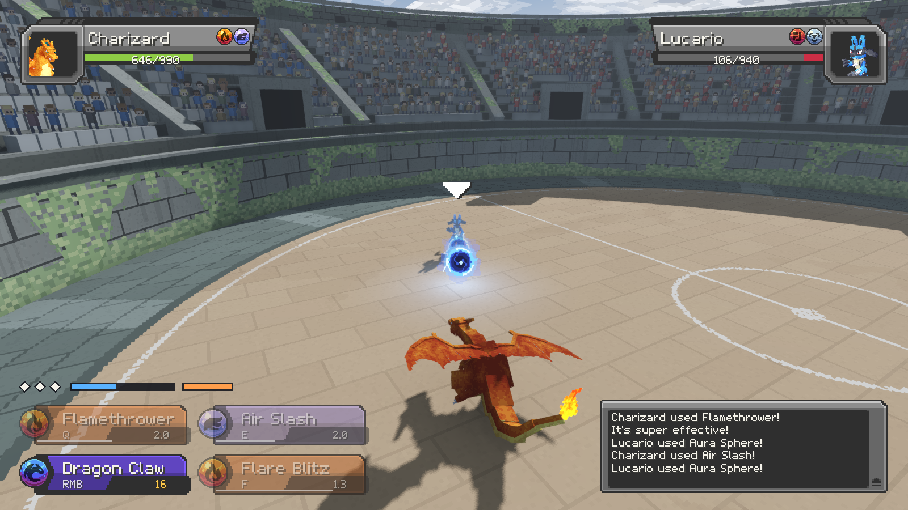
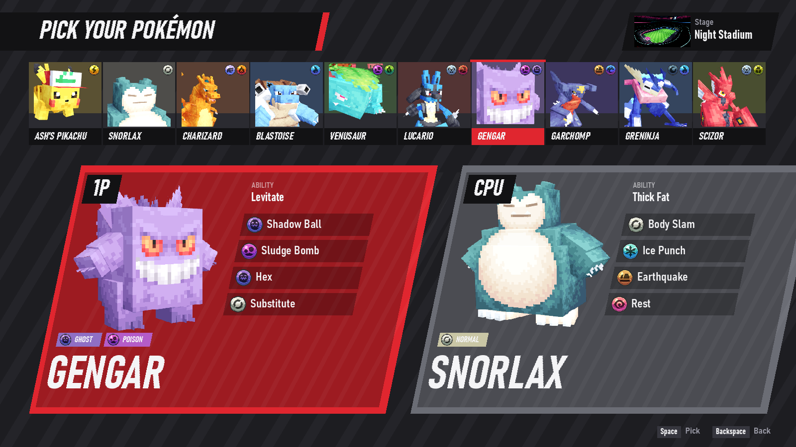
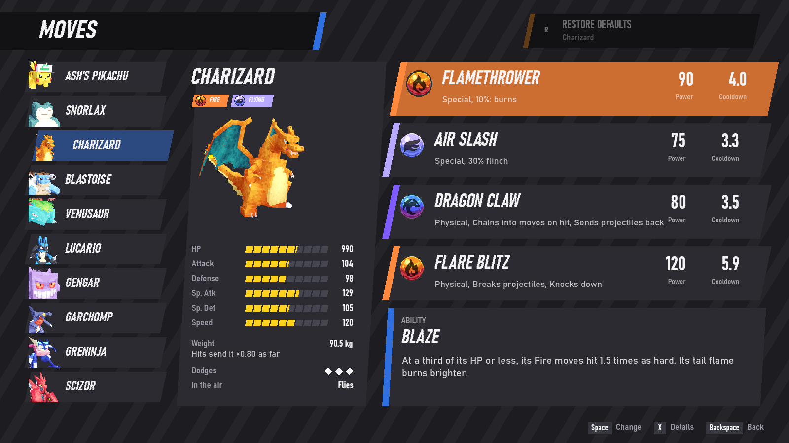

# PokeBrawl

Real-time 3D Pokémon battles in the style of the anime, built in Godot with Cobblemon's models.
Ten Pokémon, against the AI or online with a friend, 1 vs 1 or 3 vs 3.



PokeBrawl is a non-profit fan project; this is its demo, the first version to play. You
pick each Pokémon's four moves and its ability from what it learns in the games, and fight in
three stadiums. The game is in English and Spanish and follows your system language.

> **This is one way to do it, not the way.** PokeBrawl is the approach I took to real-time
> Pokémon battles, and it is not necessarily the best one. If you want to build them from the
> ground up in a completely different way, feel free to take whatever you want from this work
> for it: the code is MIT, and the assets keep their own licenses (see
> [Credits](#credits-and-licenses)).

| | |
|---|---|
|  |  |

## Download

The Windows build is on the [Releases](https://github.com/xjoje6/PokeBrawl/releases) page: unzip
it and run `PokeBrawl.exe`. It carries the music; the repository does not (see
[Credits](#credits-and-licenses)).

## Play from the source

You need [Godot 4.7.2](https://godotengine.org/download) (the standard build, not .NET).

```bash
git clone https://github.com/xjoje6/PokeBrawl.git
godot --path PokeBrawl/game
```

On Windows, `play.bat` does the same if Godot is on your `PATH` or in the `GODOT` environment
variable. `training.bat` opens the menu with training mode already picked. From the source
the game runs without music unless you add the files listed in
[game/music/README.md](game/music/README.md).

Arguments skip the menu and go straight into a battle:

```bash
godot --path game -- --p1=charizard --p2=pikachu --diff=hard --stage=league
```

| Argument | Values |
|---|---|
| `--p1`, `--p2` | `pikachu`, `snorlax`, `charizard`, `blastoise`, `venusaur`, `lucario`, `gengar`, `garchomp`, `greninja`, `scizor`, `goodra` |
| `--team`, `--team2` | a 3 vs 3 against the AI (prototype): `--team=charizard,lucario,venusaur`; the first one leads, a missing `--team2` is filled from the roster. See [3 vs 3](#3-vs-3-prototype) |
| `--rules` | that battle's 3 vs 3 rules: `--rules=recall:0.4,lockout:5,bench_heal:0.5` (the ids and limits are in [battle_rules.gd](game/scripts/data/battle_rules.gd)) |
| `--diff` | `easy`, `normal`, `hard` |
| `--stage` | `night` (default), `floating`, `league` |
| `--training` | still or active rival: **R** resets, **T** stops or frees the rival, **F3** shows the hitboxes |
| `--lang` | `en`, `es` (forces a language) |

## What is in

- **Battle** against the AI (easy, normal, hard), **Online** and **Training**, 1 vs 1 or 3 vs 3.
- **Moves:** each Pokémon's four moves and its ability, picked from the ones it learns in the
  games (82 moves and 26 abilities so far). Every move has its details: power, cooldown, reach,
  timings and how to counter it. **Restore defaults** puts them back.
- **Profile:** your trainer (nine, with the games' sprites) and your name. Your trainer stands
  by the field, throws the Poké Ball at the start and reacts to the battle; online, your rival
  sees them.
- **Three stadiums:**
  - **Night Stadium:** a Galar stadium at night, packed and walled all round. Nobody falls off.
  - **Floating Stadium:** a platform over the void. Whoever is pushed off the edge is out.
  - **League Stadium:** the League's coliseum. The field closes in by phases; outside it you
    lose HP.
- **Status conditions** as in the games, adapted to real time (burn, paralysis, poison, bad
  poison, sleep, freeze), plus confusion, and **weather** (sun, rain, sandstorm, snow).
- Keyboard, mouse and gamepad (Xbox or PlayStation) at the same time, also in the menus.

## Controls

| Action | Xbox | PlayStation | Keyboard and mouse |
|---|---|---|---|
| Move | Left stick | Left stick | WASD |
| Camera | Right stick | Right stick | Mouse |
| Jump | A | ✕ | Space |
| Dodge | B | ○ | Shift |
| Lock on / release | RS (click the right stick) | R3 | Tab or middle click |
| Switch target (locked on) | Flick the right stick | Flick the right stick | Sweep the mouse |
| Move 1 | LB | L1 | Q |
| Move 2 | RB | R1 | E |
| Move 3 | LT | L2 | Right click |
| Move 4 | RT | R2 | F |
| Pause | Menu | Options | Esc |
| Switch Pokémon (3 vs 3) | X, Y | □, △ | 1, 2 |
| Fly (Charizard, Gengar) | A in the air to take off; hold A to climb | ✕ the same | Space the same |
| Descend while flying | LS (click the left stick) | L3 | Ctrl |
| Debug view | View | Share | F3 |

In the menus: A / ✕ / Space or left click picks, B / ○ / Backspace or right click goes back,
Y / △ / X shows a move's details, and X / □ / R restores the defaults in the Moves screen. The
mouse wheel scrolls.

## How battles work

- **Four moves.** Each move costs energy and has its own cooldown. Strong moves
  recharge slowly, so it pays to carry something weak and fast too; or you can play around your
  big moves and wait for them.
- **Every move has a readable startup.** What the opponent sees coming is what they can answer:
  dodge it, jump it, step out of it or punish the recovery.
- **Dodge:** each Pokémon has a number of dodge charges. Outside its invulnerability window it
  does not protect you, and dodging back to back makes the recovery longer.
- **Poise:** every hit is light, medium or heavy. While a Pokémon winds up or performs a move,
  only a hit that reaches its poise interrupts it (the move's poise plus 1 for heavy Pokémon). The
  hit still deals its damage.
- **No infinite combos:** stun gets shorter with each hit of the same combo, and the fifth hit
  knocks the target down; it gets up with a moment of invulnerability.
- **Type matchups, softened:** super effective ×1.25 (×1.56 against a double weakness), not very
  effective ×0.8, and a quarter for immunities and double resistances. The text and the color
  of the damage tell you which.
- **Deflecting:** strong, committed physical moves (Iron Tail, X-Scissor, Close Combat...) send
  bombs and balls back if they meet them early and from the front; weak or quick ones only
  break them.
- **Everything works in the air.** Moves that need the ground (Earthquake, Dig, Stone Edge, Rest)
  dive down and happen on landing.
- **Streams are aimed by hand** (Flamethrower, Hydro Pump, Hyper Beam, Dragon Pulse, Solar Beam):
  hold the button and turn the stream with the stick; it hits several times and drains energy.
- **Lock-on** locks what the camera looks at: the rival or one of its decoys (Substitute's doll,
  Double Team's clones). Locked on, a flick of the right stick or a sweep of the mouse switches
  target. With the camera free, moves go where the camera looks; homing shots still home in.

### 3 vs 3 (prototype)

Three Pokémon a side, one on the field at a time. **Battle**, **Training** and hosting online ask
for the format first. In a 3 vs 3 each side picks three on the wall, seeing each one's model, types,
ability and moves; the first one leads, and picking one again (or clicking it on its card) takes
it out. The **Rules** tab then sets that battle's rules: they hold for its rematches and stay in
the menu until the game closes, but are never saved. Below are the defaults; every time can be
changed, along with how many switches you get, and healing on the bench, off by default.

- **A switch is a commitment.** The Pokémon stands there for about a second, glowing, while its
  trainer throws the ball, and can be hit all along: a hit that beats its poise cuts the switch.
  That is longer than nearly every move's startup, so it has to be a read, not a reaction. The
  one coming in lands in the same spot, with no invulnerability.
- **Switches are scarce.** You start with one and hold up to two; another comes every 25 s, 1 s
  sooner per hit you land. A switch that gets cut still costs it. The one that left cannot come
  back for 10 s.
- **It refreshes nothing.** The energy belongs to the team. On the bench, HP, cooldowns and status
  wait as they were. Stat stages, confusion and decoys are lost on leaving, as in the games.
- **After a KO** you pick the next one within 3 s (the healthiest if you do not). It is free, lands
  on your side with 1 s of invulnerability, and your team gets 30 energy. The Pokémon that made
  the KO loses its stat stages, so one boost does not sweep all three.
- **The League's field** closes 2.5 times slower.
- **On screen:** under each frame, that side's bench and switches, the rival's too. Above your
  energy, a chip per teammate with its button, HP, and the seconds until it can come back or its
  status. A bar over a Pokémon going back to its ball shows how long it has left.

## The roster

Default moves and ability, and the abilities each one can pick. The Moves screen has the rest.

| Pokémon | Types | Default moves | Abilities | Moves to pick from |
|---|---|---|---|---|
| **Ash's Pikachu** | Electric | Thunder Shock · Quick Attack · Iron Tail · Electro Ball | Static, Lightning Rod | 26 |
| **Snorlax** | Normal | Body Slam · Ice Punch · Earthquake · Rest | Thick Fat, Immunity, Gluttony | 37 |
| **Charizard** | Fire / Flying | Flamethrower · Air Slash · Dragon Claw · Flare Blitz | Blaze, Solar Power | 38 |
| **Blastoise** | Water | Aqua Jet · Hydro Pump · Rapid Spin · Ice Beam | Torrent, Rain Dish | 36 |
| **Venusaur** | Grass / Poison | Vine Whip · Razor Leaf · Sludge Bomb · Solar Beam | Overgrow, Chlorophyll | 23 |
| **Lucario** | Fighting / Steel | Aura Sphere · Meteor Mash · Extreme Speed · Detect | Steadfast, Inner Focus, Justified | 41 |
| **Gengar** | Ghost / Poison | Shadow Ball · Sludge Bomb · Hex · Substitute | Levitate, Cursed Body | 33 |
| **Garchomp** | Dragon / Ground | Dig · Dragon Claw · Earthquake · Stone Edge | Rough Skin, Sand Veil | 31 |
| **Greninja** | Water / Dark | Water Shuriken · Night Slash · Double Team · Hydro Pump | Protean, Torrent | 25 |
| **Scizor** | Bug / Steel | Bullet Punch · X-Scissor · Swords Dance · Wing Attack | Technician, Swarm, Light Metal | 24 |
| **Goodra** | Dragon | Dragon Pulse · Surf · Ice Beam · Body Slam | Gooey, Sap Sipper, Hydration, Overcoat | 35 |

Stats, weights and learnsets are the games' (stats at level 50). How each one moves (speed,
jumps, dodges, flight) is its own. References from Pokkén, Smash and the anime for the moves
are in [docs/move-references.md](docs/move-references.md); the plan to grow the roster is in
[docs/roster-plan.md](docs/roster-plan.md).

## Online

- Main menu → **Online**: one player picks **Host game** and the format, 1 vs 1 or 3 vs 3, the other
  **Join** and types the host's IP.
- The waiting screen shows the host's IPs: local, VPN if any, and public if the router opened the
  port by itself (UPnP). Otherwise, open port **7777 UDP** on the router or use a LAN VPN such as
  Radmin VPN or ZeroTier.
- Both pick and get ready; then VS and battle. The host picks the stadium and, in a 3 vs 3, the
  rules, and the ping is shown at the top. A 3 vs 3's teams stay hidden from the rival until both
  are ready: only how many have been picked shows.
- After a KO, a rematch starts once every player has asked for it; "pick others" goes back to
  the selection without disconnecting. With nobody choosing, the game goes back to the
  selection by itself after 15 s. There is no pause or KO slow motion online.
- Both players need the same version of the game: otherwise a notice shows and the battle
  does not start.

How it keeps latency low: ENet over UDP with small custom packets; every frame carries your input
and your own Pokémon's state unreliably, while events (hits, start, rematch) go on a reliable
channel. Each player is in charge of their own Pokémon, so your input is applied with no delay;
the rival's copy runs their presses fast-forwarded by the ping and is corrected with their real
state. Hits are confirmed by whoever takes them. In a 3 vs 3 each player is in charge of their
own team too: their switches and picks reach the rival's copy as reliable events.

## Tests

The tests are built into the game and run with `--test=NAME`:

```bash
godot --headless --path game -- --test=mechanics          # acceptance cases of the combat
godot --headless --path game -- --test=loadouts           # every Pokémon with every move it can pick
godot --headless --path game -- --test=status             # also: status_moves, abilities, new_moves
godot --headless --path game -- --test=deflect            # also: clash, lockon, league, trainers
godot --headless --path game -- --test=team               # the rules of 3 vs 3 and switching
godot --headless --path game -- --aivsai --test=team_battles --battles=20 --speed=4   # random teams: length, switches, wins
godot --path game -- --test=menu                          # the menus with simulated input
godot --path game -- --test=menu_moves                    # also: menu_options, menu_profile, menu_wheel
godot --path game -- --test=moves --p1=charizard          # every move, with captures
godot --path game -- --aivsai --test=combat               # an on-screen battle, captures and FPS
```

Online tests run two copies: `--host --bot --test=net` and `--join=127.0.0.1 --bot --test=net`
(add `--lag=ms --jitter=ms --loss=%` to simulate a bad connection), or `--test=menu_net
--role=host|guest --bot` to go through the menus. Captures go to `captures/`.

## Project layout

```
game/                 the Godot project
  scripts/            game code (fighter, combat, AI, menus, HUD, online, effects, stadiums)
    data/             roster, moves, abilities, statuses, loadouts, trainers, species (generated)
    moves/            one script per move, named by its Showdown id
    ui/               menu drawing and move details
  fx/                 Cobblemon particle pieces and move sequences, converted
  pokemon/            converted Cobblemon models, textures and cries
  sounds/             Cobblemon move, menu and Poké Ball sounds
  trainers/           trainer sprites
  music/              empty in the repository (see its README)
  i18n/               translations.csv (one column per language)
tools/                Python tools: converters, importers, sprite and font generators
sources/              original Cobblemon files the converted models come from
docs/                 design documents
```

## Contributing

Contributions are welcome, especially new moves and abilities: see
[CONTRIBUTING.md](CONTRIBUTING.md) for the recipes and the rules, and
[where it can go](CONTRIBUTING.md#where-it-can-go): more Pokémon, teams and doubles, balance,
the system inside the Pokémon games themselves, or new fan games built on it.

## Credits and licenses

Made by [xjoje6](https://github.com/xjoje6). The Pokémon are Cobblemon's; the stadiums and
effects are drawn by code.

- **Code:** MIT, see [LICENSE](LICENSE).
- **Pokémon models, animations and textures:** the [Cobblemon](https://gitlab.com/cable-mc/cobblemon)
  team, **CC BY-NC 3.0** ([game/pokemon/LICENSE-models.txt](game/pokemon/LICENSE-models.txt)),
  converted and adapted, used with their approval. Non-commercial use with attribution.
- **Particle effects, move and menu sounds, cries, Poké Ball sounds, battle GUI pieces and
  species data:** Cobblemon, under its general license (MPL 2.0).
- **Music:** Pokémon arrangements by [The Noble Demon](https://www.youtube.com/@TheNobleDemon),
  used with credit as permitted by the artist; original compositions by GAME FREAK's composers.
  Only in the released builds, not in this repository.
- **Trainer sprites:** from the Pokémon games, as [Pokémon Showdown](https://play.pokemonshowdown.com/sprites/trainers/)
  serves them.
- **Move and ability behavior:** [Pokémon Showdown](https://github.com/smogon/pokemon-showdown)
  (MIT) as the reference.
- **Engine:** [Godot Engine](https://godotengine.org) (MIT).

The full list, with the track list and the engine's notices, is in [CREDITS.md](CREDITS.md).

Pokémon and Pokémon character names are trademarks of Nintendo, Creatures Inc., GAME FREAK and
The Pokémon Company. This is a non-profit fan project, not affiliated with or endorsed by them.
